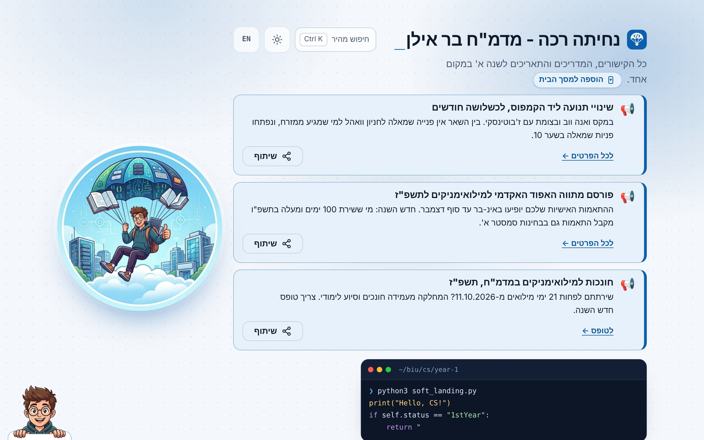
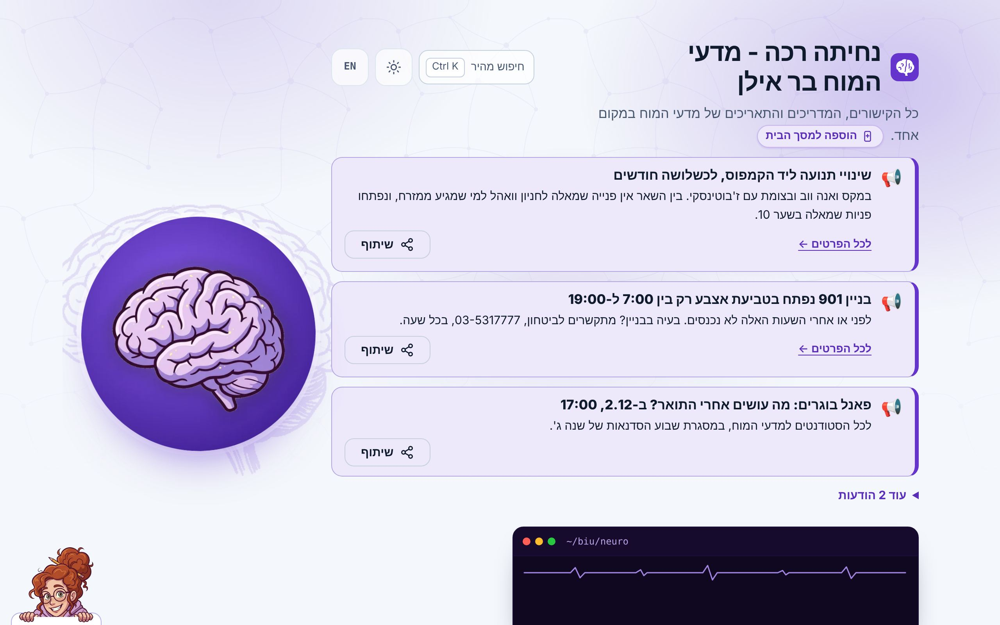
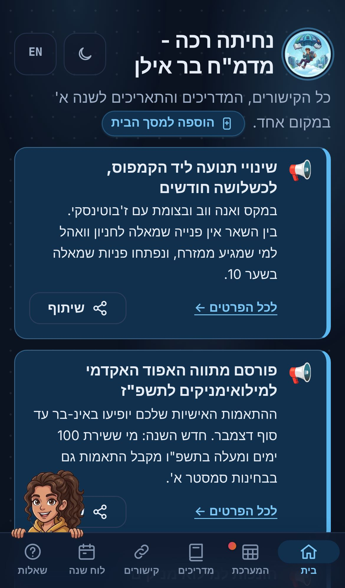
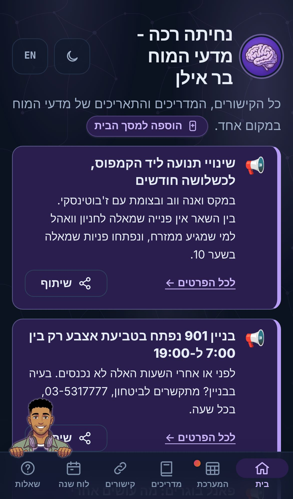
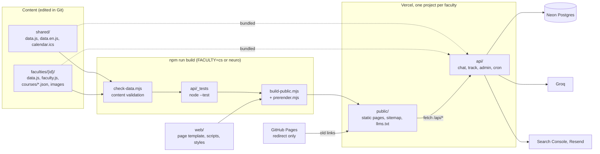

# נחיתה רכה (Soft Landing)

**One student hub per faculty for first-year students at Bar-Ilan University: links, WhatsApp groups, guides, the academic calendar, a course browser and an AI chat with its own mascots.**

[](https://github.com/Royc4515/nechita-raka/actions/workflows/check-data.yml)
[](https://github.com/Royc4515/nechita-raka/actions/workflows/deploy.yml)
[](https://nodejs.org/)
[](LICENSE)
[](https://nechita-raka.vercel.app)
[](https://nechita-raka-neuro.vercel.app)
[](https://github.com/Royc4515/nechita-raka/commits/main)

| Computer Science | Brain Sciences |
| :---: | :---: |
|  |  |
|  |  |

**Live:** [Computer Science](https://nechita-raka.vercel.app) · [Brain Sciences](https://nechita-raka-neuro.vercel.app)

An independent student initiative. Not an official site of Bar-Ilan University or the student union.

## Contents

- [About](#about)
- [Tech stack](#tech-stack)
- [Architecture](#architecture)
- [Project structure](#project-structure)
- [Getting started](#getting-started)
- [Configuration](#configuration)
- [Editing content](#editing-content)
- [Known limitations and roadmap](#known-limitations-and-roadmap)
- [Contributing](#contributing)
- [License](#license)
- [Author](#author)

## About

**The problem.** A first-year student at Bar-Ilan needs a dozen official systems, a long academic calendar, a course catalog that is hard to search, and WhatsApp groups that are passed around by word of mouth. The answers exist, but they are scattered.

**The solution.** One fast, Hebrew-first page per faculty that collects all of it, keeps it current from official sources, and answers questions in a chat that only uses that content.

Key features:

- **Links, groups and guides**: categorized links, step-by-step guides with their own pages, and an FAQ, all with sources.
- **Course browser**: search the faculty's course catalog by year, semester, day and track, build a weekly schedule, export it to a calendar, or hand it to an AI assistant with a ready prompt.
- **Academic calendar**: upcoming dates on the page and a downloadable `.ics` file with the university's and the faculty's dates.
- **AI chat**: two mascots per faculty (ביט ובייט for CS, נוי ורון for Brain Sciences) answer from the site's content only, with daily rate limits, a prompt-guard model and answer checks.
- **Search**: ranked instant search with faculty synonyms (`Ctrl K`).
- **English mode, dark mode, installable**: a full English toggle, light and dark themes, and a PWA manifest for the home screen.
- **Search engines and AI crawlers**: every page is prerendered with JSON-LD, plus `sitemap.xml` and `llms.txt`.
- **Respectful by design**: no tracking cookies, no stored IP addresses or chat text; WhatsApp links are hidden from scrapers in every published file. The site closes itself for Shabbat and changes its look on holidays and memorial days.
- **Private dashboard**: anonymous daily counters, searches that found nothing, Google Search Console data and a weekly email, behind Google sign-in.

## Tech stack

| Layer | Technology |
| --- | --- |
| Frontend | Vanilla HTML, CSS and JavaScript (ES modules), no framework or bundler |
| Build | Node.js 22 scripts: content check, prerender, static output in `public/` |
| Backend | [Vercel Functions](https://vercel.com/docs/functions) (`api/`), region `fra1`, two daily [cron jobs](https://vercel.com/docs/cron-jobs) |
| Database | [Neon](https://neon.tech/) serverless Postgres ([`@neondatabase/serverless`](https://www.npmjs.com/package/@neondatabase/serverless)) |
| AI | [Groq](https://console.groq.com/) models for answers and a prompt guard |
| Auth | Google sign-in, sessions signed with [`jose`](https://www.npmjs.com/package/jose) |
| Integrations | Google Search Console through Workload Identity ([`google-auth-library`](https://www.npmjs.com/package/google-auth-library), [`@vercel/oidc`](https://www.npmjs.com/package/@vercel/oidc)), [Resend](https://resend.com/) for email |
| Tests and CI | Node's built-in test runner, GitHub Actions per faculty |
| Hosting | Vercel (one project per faculty); GitHub Pages serves only a redirect for old links |

## Architecture



- **One codebase, many faculties.** The `FACULTY` environment variable picks a manifest ([`faculties/index.js`](faculties/index.js)). Everything that differs between faculties (name, colors, mascots, hero, course categories, tracks, search synonyms) lives in `faculties/<id>/faculty.js`. Shared Bar-Ilan content is merged with the faculty's own by [`faculties/content.js`](faculties/content.js).
- **Build.** [`scripts/check-data.mjs`](scripts/check-data.mjs) validates the content, the test suite runs, then [`scripts/build-public.mjs`](scripts/build-public.mjs) copies [`web/`](web/) flat into `public/` and [`scripts/prerender.mjs`](scripts/prerender.mjs) writes the content into the HTML, one page per guide and notice. Guards fail the build if a WhatsApp link or another faculty's data reaches `public/`.
- **Server.** Thin handlers in [`api/`](api/) call the logic in [`api/_lib/`](api/_lib/): the chat ([`chat/handler.js`](api/_lib/chat/handler.js): retrieval over the content, rate limiter, guard, answer checks), anonymous counters ([`stats/`](api/_lib/stats/)), the dashboard ([`admin/`](api/_lib/admin/)) and the Search Console sync ([`search/`](api/_lib/search/)).
- **Deploy.** Vercel builds each faculty with `npm run build` ([`vercel.json`](vercel.json)). GitHub Actions run the same build for both faculties on every branch ([`check-data.yml`](.github/workflows/check-data.yml)) and publish the [`redirect/`](redirect/) page to GitHub Pages from `main` ([`deploy.yml`](.github/workflows/deploy.yml)).

## Project structure

```text
.
├── web/                  Browser source, published flat to public/
│   ├── index.html        Page template (markup, styles, page script)
│   ├── chat.js, peek.js  The chat panel and the peeking mascot
│   ├── course-*.js       The courses page: browser, schedule, calendar export, AI prompt
│   ├── shabbat*.js       Shabbat times and the Shabbat rest screen
│   ├── track.js          Anonymous page-view and click counters
│   ├── admin.html/.js    The private dashboard (/admin)
│   └── icons/            Shared app icons
├── shared/               Bar-Ilan content shared by every faculty (Hebrew, English, calendar)
├── faculties/
│   ├── index.js          Faculty registry and manifest validation
│   ├── content.js        Merges shared and faculty content
│   ├── cs/               Computer Science: manifest, content, courses, mascots, images
│   └── neuro/            Brain Sciences: same shape, plus catalog tools
├── api/                  Vercel Functions
│   ├── _lib/             Chat, stats, admin, search and course logic
│   └── _tests/           Test suite (node --test)
├── scripts/              Build, prerender, content check, simulations, review tier
├── docs/                 Editing manual (Hebrew), plans, audit, screenshots
├── management/           Working memory of the AI agent team: roadmap, backlog, decisions, reviews
├── redirect/             GitHub Pages page that forwards old links
├── .claude/              Role agents and the /board skill
└── vercel.json           Build, functions, crons and headers
```

## Getting started

### Prerequisites

- [Node.js](https://nodejs.org/) 22 and npm
- Python 3 (optional, only for the quick local server below)

### Install, test and build

```bash
npm ci
```

```bash
npm test
```

```bash
FACULTY=cs npm run build
```

`npm run build` runs the content check, the full test suite and the static build into `public/`. Use `FACULTY=neuro` for the Brain Sciences site. `npm run check` runs only the content check.

### Run locally

```bash
python3 -m http.server 8000 -d public
```

Open <http://localhost:8000>. Guide pages open with their extension locally (`/exams.html`); on Vercel they also open without it (`/exams`). Add `?today=2027-01-20` to the address to see the page on another date.

The static server does not run the `api/` functions, so the chat and the dashboard are off locally. To run them, use the Vercel CLI as described in [management/simulations/README.md](management/simulations/README.md#running-the-api-locally).

## Configuration

The static site needs no configuration. The server reads its settings from Vercel environment variables, one set per faculty project; every variable is listed with a short description in [`.env.example`](.env.example). Without them the chat, the counters and the dashboard answer `503` instead of failing. The main groups:

| Feature | Variables |
| --- | --- |
| Faculty | `FACULTY` (`cs` by default, `neuro`) |
| Chat | `GROQ_API_KEY`, `DATABASE_URL`, `CHAT_SALT` (all required), optional caps and models |
| Dashboard | `GOOGLE_CLIENT_ID`, `ADMIN_EMAILS`, optional `ADMIN_SESSION_SECRET` |
| Weekly email | `RESEND_API_KEY`, optional `REPORT_EMAIL`, `REPORT_FROM`, `CRON_SECRET` |
| Search Console | `GCP_*` Workload Identity settings and `GSC_SITE_URL` |

The full setup, in Hebrew, is in [docs/EDITING.md](docs/EDITING.md).

## Editing content

Content is plain JavaScript that can be edited from the GitHub web UI, even on a phone: [`shared/data.js`](shared/data.js) for everything Bar-Ilan-wide, `faculties/<id>/data.js` for one faculty. The build checks every change before it goes live, and the chat picks it up automatically.

The step-by-step manual (Hebrew) is **[docs/EDITING.md](docs/EDITING.md)**: adding links, categories, dates, guides, notices, FAQ answers and English pairs, the chat, the dashboard, special days and faculties. Course catalog scans are documented per faculty ([CS](faculties/cs/courses/README.md), [Brain Sciences](faculties/neuro/courses/README.md)).

## Known limitations and roadmap

- The Shabbat rest screen does not yet cover Yom Tov (festival days); see "ימים מיוחדים" in [docs/EDITING.md](docs/EDITING.md).
- Course data comes from periodic catalog scans, so groups and rooms can lag behind the official catalog between scans.
- The chat runs on Groq's free tier with daily caps (150 messages a day per site, 15 per visitor), so it can answer "busy" on peak days.
- Search Console and the weekly email are not yet set up for the Brain Sciences site ([roadmap](management/ROADMAP.md)).

The roadmap and backlog are kept in [management/ROADMAP.md](management/ROADMAP.md) and [management/BACKLOG.md](management/BACKLOG.md); planning documents are in [docs/](docs/). Changes are listed in the [changelog](CHANGELOG.md).

## Contributing

Corrections with an official source are the most useful contribution. See [CONTRIBUTING.md](CONTRIBUTING.md) for reporting issues, editing content and changing code.

## License

[MIT](LICENSE) © 2026 Roy Carmelli

## Author

**Roy Carmelli** · [GitHub](https://github.com/Royc4515) · [LinkedIn](https://www.linkedin.com/in/roy-carmelli)

The course catalog data was collected with [biu-courses-crawler](https://github.com/Royc4515/biu-courses-crawler).
