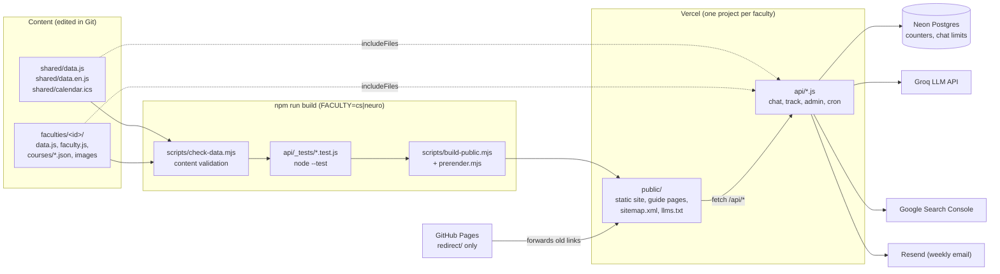

# Repository audit: nechita-raka

Date: 25.11.2026. Branch: `chore/repo-polish`. Based on `main` at `f39d8c6`.

## 1. What the project is

נחיתה רכה ("Soft Landing") is an independent student hub for first-year students at Bar-Ilan University: important links, WhatsApp groups, the academic calendar, step-by-step guides, a course browser built from the course catalog, and an FAQ. One codebase builds two sites, one per faculty (Computer Science and Brain Sciences), each with its own content, colors and a pair of mascots that answer questions in an AI chat. Content lives in plain JavaScript data files that can be edited from the GitHub web UI on a phone; a build step validates the content, runs the tests and prerenders static HTML for search engines. A small Vercel serverless backend runs the chat, anonymous usage counters, a private admin dashboard and two daily cron jobs.

## 2. Architecture



- **Browser**: `index.html` is the page template. The build writes the merged content into it (prerendering) and copies the browser scripts (`chat.js`, `course-*.js`, `shabbat*.js`, `track.js`, `peek.js`, `admin.*`) flat into `public/`.
- **Faculties**: `faculties/index.js` loads the manifest picked by the `FACULTY` env var (default `cs`). `faculties/content.js` merges `shared/` with `faculties/<id>/`. A faculty guard fails the build if one faculty's data leaks into the other's bundle.
- **Server**: `api/chat.js`, `api/track.js`, `api/admin/*.js`, `api/cron/*.js` are thin Vercel handlers; logic is in `api/_lib/` (chat, admin, stats, search, courses).
- **Deploy**: Vercel builds each faculty (`vercel.json`: build `npm run build`, output `public/`, region `fra1`). GitHub Actions run the check per faculty on branches (`check-data.yml`) and publish `redirect/` to GitHub Pages from `main` (`deploy.yml`).

## 3. Stack, versions, how to run

| Item | Value | Source |
| --- | --- | --- |
| Runtime | Node.js 22 (CI), ES modules | `.github/workflows/*.yml`, `package.json` `"type": "module"` |
| Frontend | Vanilla HTML/CSS/JS, no framework, no bundler | `index.html`, root `*.js` |
| Backend | Vercel serverless functions | `vercel.json`, `api/` |
| Dependencies | `@neondatabase/serverless`, `@vercel/oidc`, `google-auth-library`, `jose` | `package.json` |
| Tests | Node built-in test runner (`node --test`) | `package.json` |
| Data tools | Python (`extract.py`) and Node scripts for the neuro catalog | `faculties/neuro/courses/tools/` |

Commands (all run successfully in this audit, Node v22.23.5, npm 10.9.9):

```bash
npm ci --no-audit --no-fund
npm run check
npm test
FACULTY=cs npm run build
FACULTY=neuro npm run build
```

**Baseline**: `npm ci` OK (49 packages). `npm run check` OK with one existing warning (CS guide "מרחב הלמידה של מדמ"ח" has no `sources`). `npm test`: **236 tests, 236 pass, 0 fail**. Build OK for both faculties (CS: 16 guide pages, 155 courses). The `public/` output of both builds was saved so every later step can be diffed byte for byte against it.

Live: <https://nechita-raka.vercel.app> (CS, 200), <https://nechita-raka-neuro.vercel.app> (neuro, 200), <https://royc4515.github.io/nechita-raka/> (redirect, 200). GitHub environments: `Production – nechita-raka`, `Preview – nechita-raka`, `github-pages`.

## 4. Findings

| # | Severity | Finding |
| --- | --- | --- |
| 1 | high | No `LICENSE`. The repo is public, so by default nobody may reuse the code. Needs an owner decision. |
| 2 | medium | `README.md` (44 KB, Hebrew) is an editor's manual, not a project README. A visitor gets no overview, stack, architecture or setup. The manual itself is valuable and is linked from code comments and agent files. |
| 3 | medium | 20 browser files (`chat.js`, 11 `course-*.js`, `shabbat*.js`, `peek.js`, `track.js`, `admin.*`, CSS) sit flat in the repo root next to docs and config, which makes the root hard to scan. |
| 4 | medium | Three long planning documents (`MANAGEMENT-PLAN.md`, `MULTI-FACULTY-PLAN.md`, `SEO_REPORT.md`) sit in the root; `docs/` does not exist. |
| 5 | medium | No `.env.example`, although the server reads 23 environment variables (documented only inside the Hebrew README tables). |
| 6 | low | `check-data.yml` path filter lists `biu-5787.ics`, a root file that no longer exists (the calendar moved to `shared/calendar.ics`, already covered by `shared/**`). Harmless but stale. |
| 7 | low | `.nojekyll` in the root is unreferenced and has no effect: Pages publishes the `redirect/` artifact through Actions, not the branch root. |
| 8 | low | `assets/soft-landing.webp` is not referenced by any page or script (only by a QA note), but the build copies all of `assets/` to `public/`, so it is published at `/assets/soft-landing.webp`. |
| 9 | low | `package.json` `description` still says "first-year CS students ... Bit and Byte chat"; the project now serves two faculties. No `engines` field although CI pins Node 22. |
| 10 | low | No `.editorconfig`, `CONTRIBUTING.md`, `CHANGELOG.md`, issue or PR templates. |
| 11 | low | GitHub metadata: description is Hebrew-only and CS-only, no topics. |
| 12 | info | No committed secrets found (scanned for API key, token, private key and credentialed DB URL patterns; the one hit is a dummy `postgres://u:p@host` in a test). `.env*` is gitignored. |
| 13 | info | `management/` holds 2.1 MB of screenshots used as review evidence. Kept as is: it is the agents' working memory. |
| 14 | info | Editing comments in `shared/data.js` or `faculties/*/data.js` changes the site's "last updated" date (`scripts/prerender.mjs` `lastUpdated` uses `git log` on those files). So this polish must not touch those files, even in comments. |

## 5. Proposed structure

Principle: keep every published URL and every build output byte-identical. Vercel requires `api/` at the root; `shared/`, `faculties/`, `scripts/`, `management/`, `redirect/` already follow a clear convention and stay.

Before (root):

```text
.
├── MANAGEMENT-PLAN.md
├── MULTI-FACULTY-PLAN.md
├── README.md            (Hebrew editor manual)
├── SEO_REPORT.md
├── admin.html  admin.js
├── chat.css  chat.js  peek.js  track.js
├── course-*.js (11)  course-browser.css
├── shabbat.css  shabbat.js  shabbat-times.js
├── index.html  robots.txt
├── assets/  icons/
├── api/  faculties/  shared/  scripts/  management/  redirect/
├── .nojekyll
└── package.json  vercel.json
```

After (root):

```text
.
├── README.md            (new, English project README)
├── LICENSE  CHANGELOG.md  CONTRIBUTING.md  .editorconfig  .env.example
├── web/                 (everything the browser loads, copied flat to public/)
│   ├── index.html  admin.html  robots.txt
│   ├── *.js  *.css
│   ├── assets/
│   └── icons/
├── api/                 (Vercel functions, unchanged)
├── faculties/  shared/  (content, unchanged)
├── scripts/             (build and tools, paths updated)
├── docs/
│   ├── EDITING.md       (the current Hebrew README, unchanged text)
│   ├── MANAGEMENT-PLAN.md  MULTI-FACULTY-PLAN.md  SEO_REPORT.md
│   ├── REPO_AUDIT.md
│   └── assets/          (README screenshots)
├── management/  redirect/  .claude/  .github/
└── package.json  vercel.json
```

## 6. Planned moves, renames, deletions

Moves (all with `git mv`, history kept):

| From | To | Why |
| --- | --- | --- |
| `README.md` | `docs/EDITING.md` | Keep the Hebrew editor manual intact; free `README.md` for a real project README. |
| `MANAGEMENT-PLAN.md`, `MULTI-FACULTY-PLAN.md`, `SEO_REPORT.md` | `docs/` | Planning docs out of the root. |
| `index.html`, `admin.html`, `robots.txt`, 19 `*.js`/`*.css` browser files, `assets/`, `icons/` | `web/` | One folder for the browser source; `public/` paths stay flat and identical. |

Reference updates that come with the moves: `scripts/build-public.mjs` (source dir), `scripts/check-data.mjs`, `scripts/prerender.mjs` and other scripts that read the template, the tests in `api/_tests/` that read browser files, `check-data.yml` path filters, links and paths in `docs/`, `management/`, `.claude/agents/`, `.claude/skills/`, and code comments that name the files. Not touched: `shared/data*.js`, `faculties/*/data*.js` (see finding 14); a "ראו README" comment there will still land on the new README, which links to the manual first.

Deletions (need approval):

| File | Why |
| --- | --- |
| `.nojekyll` | Unreferenced, no effect with Actions-based Pages. |
| `assets/soft-landing.webp` | Not used by any page; currently published without purpose. |

Small fixes: drop the stale `biu-5787.ics` path from `check-data.yml`; update `package.json` description and add `engines.node >= 22`.

Verification after each step: `npm test`, `FACULTY=cs|neuro npm run build`, and `diff -r` of `public/` against the saved baseline (must be identical except for intended deletions).
